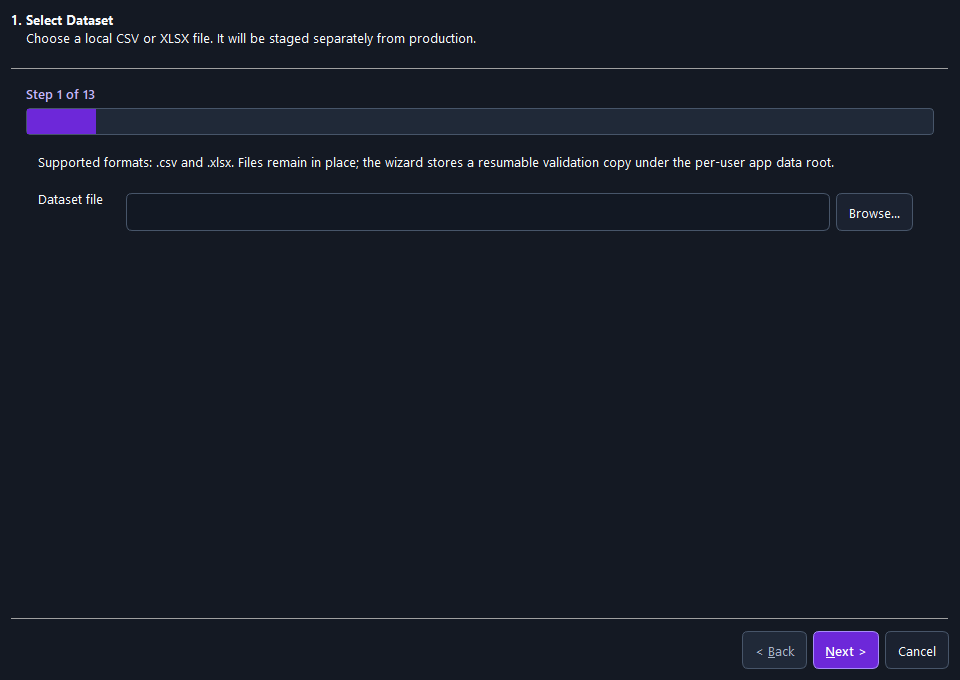
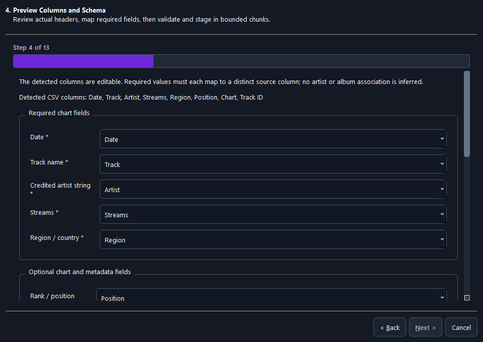
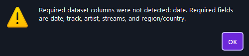
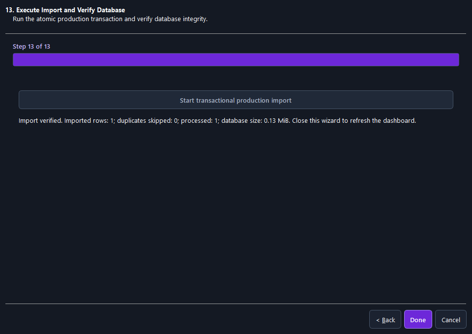

> Historical report: the wizard and mandatory manifest described here have been replaced. See [SIMPLE_IMPORT_INTERFACE.md](SIMPLE_IMPORT_INTERFACE.md) for the current workflow.

# Import wizard UI repair

## Root cause

The main window's stylesheet set light text on every descendant `QWidget` and
`QLabel`, but specified a dark surface only for the main window and selected
named panels. Dialogs and wizard pages retained the Windows light palette.
`QWizard.ModernStyle` also used platform-dependent header surfaces. Consequently,
inputs were dark while wizard backgrounds and message boxes remained light.
The original mapping grid had insufficient row spacing for the styled controls.

## Changes

- `ui/theme.py` installs the Fusion style, a complete dark application palette,
  and shared styles before startup messages. Qt dialogs are used consistently
  instead of native dialogs that can ignore these styles.
- Explicit surfaces cover `QDialog`, `QWizard`, `QWizardPage`, `QMessageBox`,
  `QProgressDialog`, scroll areas and their contents. Importantly, the wizard's
  internal `QWizard > QWidget` and `QWizard QFrame` surfaces are also styled:
  a rendered screenshot caught these remaining white header/footer surfaces.
- Labels, group headings, inputs, combo popups, text editors, progress bars,
  primary/secondary buttons, disabled controls, and keyboard focus have explicit
  readable colors. Existing reusable `QMessageBox` calls inherit this theme.
- All 13 pages use Classic wizard layout, a step counter and progress indicator,
  and vertically scrollable content with fixed accessible navigation. Initial
  size is bounded by the screen's available geometry.
- Required mappings and optional metadata have separate groups, aligned form
  rows, generous spacing, and live missing-mapping feedback. Validation actions
  stack vertically. Controls can be reached by scrolling without covering Next.
- Validation pages show reports appropriate to their step instead of repeating
  the entire raw summary and field-mapping JSON on six successive pages.
- Main window dialogs share the dark surfaces. Header actions and filters use
  multiple rows, page headings wrap, and the initial/minimum window sizes allow
  smaller screens. Primary purple was darkened to meet text contrast targets.

No acquisition, validation, authorization, or production-import rules were changed.
Existing uncommitted project changes were retained.

## Contrast

WCAG relative-luminance ratios (normal-text threshold 4.5:1):

| Foreground / background | Ratio | Use |
|---|---:|---|
| `#F8FAFC` / `#141923` | 16.82 | Dialog labels and headings |
| `#F8FAFC` / `#121823` | 17.00 | Input text |
| `#FFFFFF` / `#6D28D9` | 7.10 | Primary buttons |
| `#C4B5FD` / `#141923` | 9.53 | Step counter |
| `#A8B3C7` / `#202938` | 6.92 | Disabled controls |
| `#34D399` / `#141923` | 9.16 | Positive mapping feedback |
| `#FDE68A` / `#141923` | 14.13 | Missing mapping feedback |

Regression tests inspect computed widget palettes and actual rendered header,
footer, dialog-background pixels. They also check navigation bounds, mapping
control intersections, horizontal overflow, scroll access to staging actions,
all page headings, and multiple window sizes. They do not merely inspect text.

## Rendered verification

`python scripts/run_ui_visual_qa.py` renders nine combinations: 1366×768,
1600×900, and 1920×1080, each at 100%, 125%, and 150% effective Qt scaling.
The harness reserves space for title bars/taskbars and records the actual device
pixel ratio. These are simulated resolution constraints and Qt process scaling,
not changes to the physical Windows display settings.

Artifacts are under `build/visual-qa/matrix/<resolution>-<scale>/`:

- `step-01.png` through `step-13.png`: every actual wizard page.
- `mapping-top.png`, `mapping-bottom.png`: both ends of the scrolling form.
- `warning-no-file.png`, `warning-invalid-file.png`,
  `warning-missing-columns.png`, `warning-permission-unverified.png`.
- `error-import-denied.png`: real permission-denied finalization error displayed
  through the wizard's error handler.
- `result-verified-import.png`: actual successful isolated synthetic transaction.
- `duplicate-conflict-report.png`: actual duplicate/conflict fixture, import blocked.
- `dashboard-01.png` through `dashboard-07.png`: all seven main application pages.
- `desktop-selection.png`, `desktop-result.png`: attempted desktop captures; these
  returned black images and are not accepted as visual evidence.
- `results.json` and aggregate `matrix.json`: platform, device pixel ratio, counts,
  and screenshot inventory.

The native Windows Qt platform was available. Native widget screenshots were
opened and inspected, including selection, required/optional mapping sections,
warning/error dialogs, validation, coverage, permission/confirmation, and the
verified result. A contact sheet was used to review all pages and dashboards.
The initial offscreen renderer produced missing-font squares in this environment;
Windows rendering supplied actual system fonts and was used for visual QA.

The harness creates fresh synthetic files, a staging database, and a production
database under its output directory. One valid row is accepted and imported;
one invalid-date row is rejected. The production row count is queried and SQLite
integrity must return `ok`. A separate fixture verifies one exact duplicate and
an actual conflicting observation. A synthetic-only reviewed manifest authorizes
only the generated fixture, never real user data. Success is not simulated.

## Checks and packaged release

- Full suite: `python -m pytest -q` — **113 passed**, including the 500,000-row
  benchmark (260.11 seconds).
- UI checks were repeated after visual refinements, including palette, geometry,
  workflow, dashboard, and metadata screens.
- `python -m compileall -q src scripts tests` — passed.
- `git diff --check` — passed (existing CRLF conversion notices only).
- Pytest temporary/cache paths were redirected under `build/` because the default
  temporary directory and existing `.pytest_cache` were inaccessible.
- PowerShell's execution policy blocks direct `.ps1` invocation. The authorized
  build scripts are invoked with a process-local `-ExecutionPolicy Bypass`;
  no persistent execution policy is changed.

- Windows build: **passed**, using `scripts/build_windows.ps1 -SkipTests` after
  the full suite had passed. PyInstaller rebuilt the complete Windows x64 bundle.
- `scripts/verify_release.ps1`: **passed**; startup, restart, persisted marker,
  SQLite integrity, and all six CSV/XLSX export checks succeeded.
- The new EXE ran `--wizard-visual-qa` twice on the Windows Qt platform: at
  862?432 logical pixels with 150% device scaling, and 960?680 at 100% scaling.
  Both runs exited **0**, exercised all 13 wizard pages and seven dashboards,
  captured actual warnings/results, imported one synthetic row, rejected the
  invalid-date row, verified integrity, and detected the separate duplicate and
  conflict fixture. Packaged header/footer pixel and overflow assertions passed.
- Packaged screenshots were opened and inspected: selection, mapping top/bottom,
  missing-column warning, import-denied error, dates, coverage, and final verified
  result. The final screenshot confirms disabled primary buttons are visibly
  disabled and report text is aligned to the top.
- Final focused UI suite after refinements: **18 passed** (8.99 seconds).
- Executable: `dist/USMusicChartsAnalytics/USMusicChartsAnalytics.exe`.
- Executable SHA256:
  `9ACA8469CD771827FD7619A2086770A33937C9705EA1A5777B4820D5A9C90E1D`.
- Build log: `build/ui-build.log`; release log:
  `build/ui-release-verification.log`. Bundle hashes: `dist/USMusicChartsAnalytics/SHA256SUMS.txt`.

Representative evidence from the rebuilt executable is retained in
[`screenshots/import-wizard/`](screenshots/import-wizard/), including all 13
pages, seven dashboards, warnings/errors, the result, and JSON inventories.
Full-resolution/scaling artifacts remain in `build/visual-qa/`.

## Limits

Desktop-wide Windows screen capture returned black images in this session.
**Manual native desktop visual QA remains outstanding**, including the OS title
bar, desktop composition, and physical display interactions. Native Windows Qt
widget rendering and actual packaged execution were verified; they do not prove
those desktop behaviors. Actual Windows display-resolution/DPI setting changes,
multiple physical monitors, and manual human interaction are not claimed.
Automated Windows widget rendering, palette/pixel inspection, navigation, and
real isolated transactions cover the application content. Long mapping/report content intentionally scrolls vertically.
