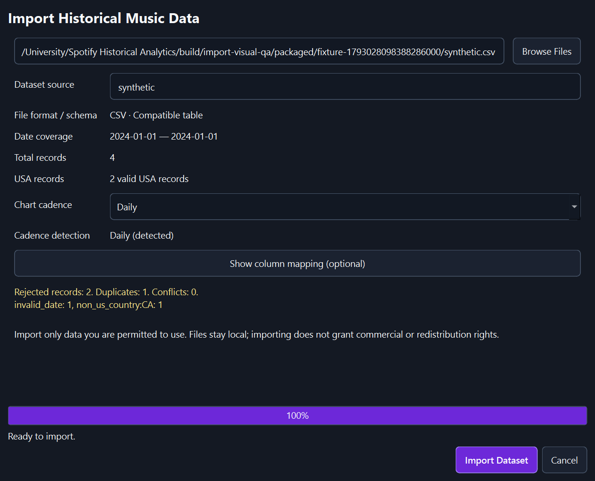
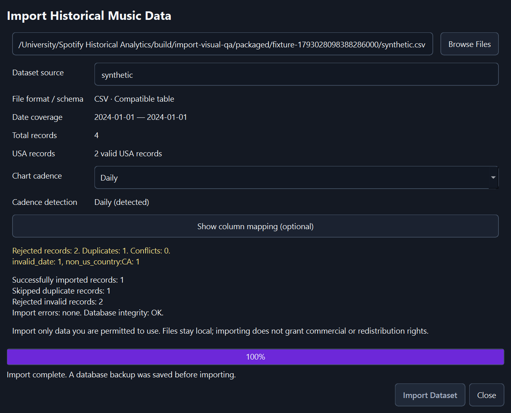
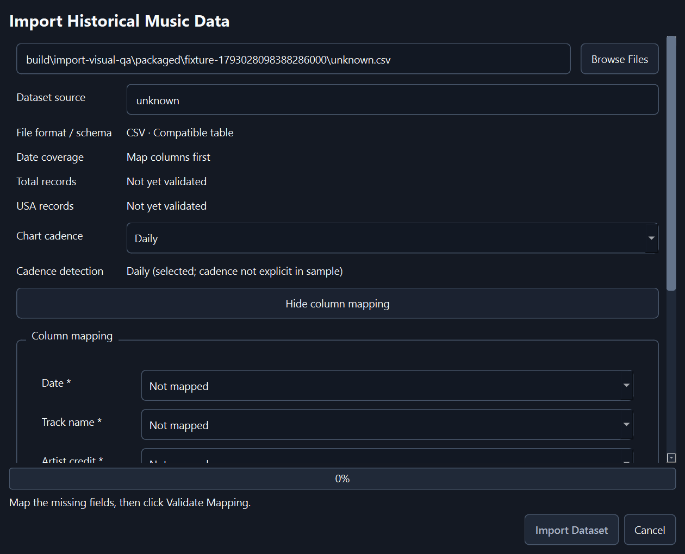
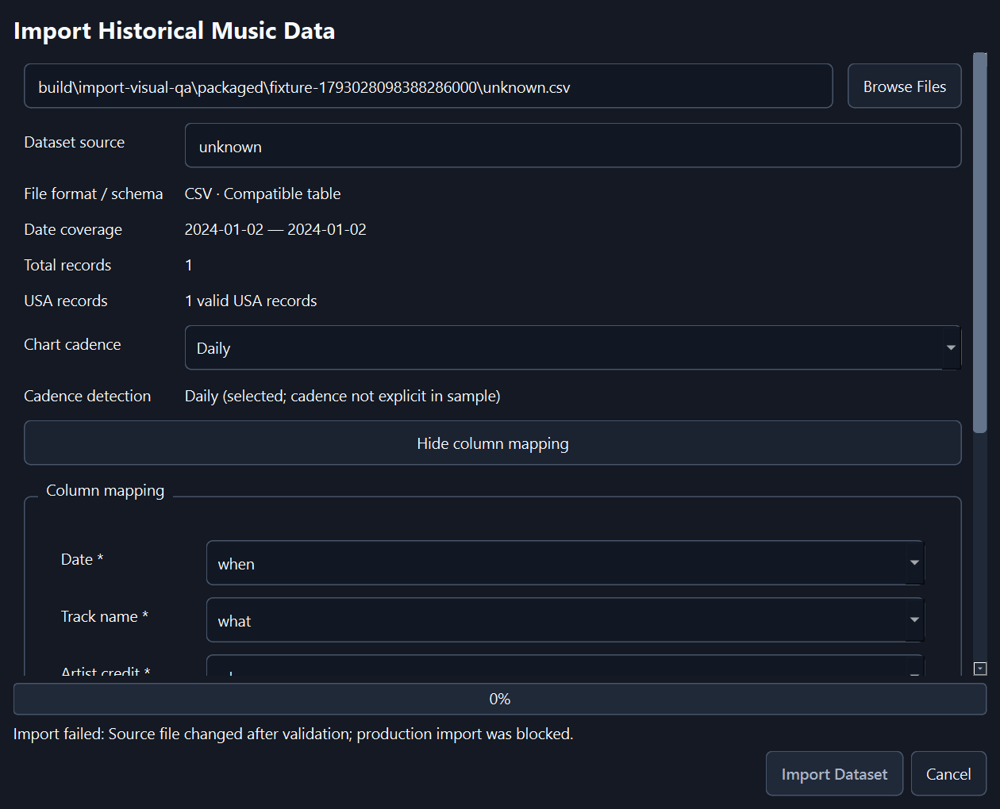

# Simple historical data import

## Current workflow

Click **Import Dataset**, choose a CSV, XLSX, or supported CSV.GZ file, review
the detected source/schema, cadence, valid USA records, date coverage, and
validation warnings, then click **Import Dataset**. The same dialog shows
progress and the final imported, duplicate, rejected, and error counts.

The mandatory JSON rights manifest and the entire 13-page wizard are removed.
There are no reviewer/evidence fields, permission-file selectors, Back/Next
pages, approval questionnaires, or saved-session startup prompts. Unknown
schemas can use five required mappings in the same dialog; optional chart and
artist/album mappings expand separately. Known source schemas map automatically.

## Files changed for this replacement

| File | Change |
|---|---|
| `src/spotify_historical_analytics/ui/import_dialog.py` | New single dialog and background preview/import worker |
| `src/spotify_historical_analytics/ui/import_wizard.py` | Removed |
| `src/spotify_historical_analytics/import_sessions.py` | Retain chunked staging/validation; add compressed CSV and delimited tables, detect known schemas, remove manifest processing/gate, preserve transactional finalization and provenance, support cancellation |
| `src/spotify_historical_analytics/ui/main_window.py` | Route every import entry point to the dialog; remove resume/authorization UI; update import/metadata explanations |
| `src/spotify_historical_analytics/ui/theme.py` | Retain readable shared dark styling; remove wizard-only selectors |
| `src/spotify_historical_analytics/ui/visual_qa.py` | Replace wizard QA with real file-chooser/dialog automation |
| `src/spotify_historical_analytics/__main__.py` | Replace obsolete diagnostic flag with `--import-visual-qa` |
| `src/us_music_charts_analytics.egg-info/SOURCES.txt` | Replace deleted wizard paths in the existing source inventory |
| `scripts/run_ui_visual_qa.py` | Render the new dialog at nine simulated resolution/scaling combinations |
| `tests/test_import_dialog.py` | New dialog, format, adapter, import, cancellation, mapping, backup, provenance, and weekly separation checks |
| `tests/test_import_wizard.py` | Removed |
| `tests/test_import_sessions.py` | Replace manifest tests with local-import, fingerprint, rollback, and audit-preservation checks |
| `tests/test_ui_visibility.py` | Replace wizard checks with dialog contrast/geometry/scroll checks |
| `tests/test_ui_smoke.py` | Update import action wording |
| `README.md`, `docs/CLIENT_REQUIREMENTS.md`, `docs/DATA_IMPORT_ACCEPTANCE.md`, `docs/DATA_IMPORT_INSTRUCTIONS.md` | Current client instructions, format limits, and distinction from controlled research transfers |
| `docs/IMPORT_WIZARD_UI_FIX.md`, `docs/IMPORT_WIZARD_QA.md`, `docs/PHASE_8B_IMPORT_WORKFLOW.md` | Mark earlier wizard reports as historical and point here |
| `docs/SIMPLE_IMPORT_INTERFACE.md`, `docs/screenshots/simple-import/` | This report and current rendered evidence |

Pre-existing analytics, database, documentation, and other uncommitted changes
were preserved. Generated build outputs and bytecode are not application features.

## Formats and source detection

- CSV and CSV.GZ use streaming readers with comma, tab, or semicolon detection.
- XLSX uses read-only workbook iteration on the active worksheet.
- MGD+ chart tables are recognized from the actual `ID`, `Track`, `Artist`,
  `Position`, `Streams`, `Trend`, `Date`, `Chart`, and `market` columns. Stable
  IDs and explicit markets are preserved, and the existing daily semantics apply.
- Dhruvil tables are recognized from the existing adapter's exact header set.
  Spotify track IDs are extracted only from verified Spotify track URLs.
  Streamless viral observations are rejected rather than converted to totals.
- Compatible standard tables map common aliases automatically. Unknown headers
  require explicit field mapping. No missing country, date, artist, or metric is
  invented. Zero is a valid supplied stream count; negative/missing values fail.
- Cadence detection samples up to 200 source rows and uses explicit daily/weekly
  fields, known adapter semantics, or supplied weekly boundary columns. Every
  row is subsequently validated. The selected cadence controls the import;
  other cadences are rejected and reported, never mixed into totals.
- No standalone Zenodo weekly adapter exists in this repository. Compatible
  weekly tables work when explicit start/end dates are present. Weekly periods
  are not fabricated from gaps or chart dates.
- Existing ZIP archive and metadata research adapters remain available to their
  research tools. ZIP and research SQLite databases are not selectable import
  formats in the client dialog.

## Database and source safeguards

The selected file is fingerprinted, validated in a separate staging database,
and fingerprinted again before production writes. Changed sources, malformed
schemas, zero valid USA records, and conflicting observations block import.
Production insertion, metadata associations, and provenance share one transaction.
Exact duplicates are skipped. Supplied artist/album IDs and verified names are
required for their associations. Daily and weekly records remain separate.
SQLite integrity is checked before commit.

A SQLite backup is created before importing, under the production database's
`backups/` directory. Cancellation waits for the worker and rolls back an active
production transaction; worker threads are not killed during database operations.
Streaming validation retains safe chunk boundaries. Backend staging facilities
remain shared infrastructure, with no session-management UI.

Removing the upload requirement does not assert permission to distribute data.
Local imports retain their source name, source file hash, and an explicit note
that permissions are not independently verified and no commercial/redistribution
rights are granted. They do not generate approval records or set sources to
approved. Existing production audit tables and historical evidence are preserved.
The separate `research_pipeline.py` approval restrictions are unchanged. Existing
research staging is neither automatically promoted nor included in the EXE.

## Automated and rendered verification

Tests cover CSV, CSV.GZ, XLSX, known MGD+/Dhruvil detection, optional mapping,
explicit weekly imports, daily/weekly separation, invalid dates, non-US rejection,
duplicate prevention, metadata associations, source changes after preview,
unvalidated imports, backup creation, safe cancellation, transactional rollback,
database persistence/integrity, palette contrast, layout intersections, fixed
action-button bounds, and scrolling. Existing analytics, dashboard filters,
search, exports, demo mode, and research tests are retained.

The Windows Qt QA harness opens the actual **Browse Files** chooser, selects a
synthetic CSV through its filename control, previews and imports it, exercises
unknown-schema mapping, blocks a file changed after validation, and cancels an
active operation. It also captures all seven dashboard pages. Test data, backups,
staging, and production databases are isolated under `build/import-visual-qa/`.
The user's production database is not used by these checks.

Expected and asserted fixture results: four source records, two valid USA rows,
two rejections (invalid date and non-US), one imported record, one duplicate
skipped, an existing backup, and SQLite integrity `ok`. No permission manifest is
created, and zero rights-approval records are inserted.

Nine matrix combinations cover 1366×768, 1600×900, and 1920×1080 at 100%, 125%,
and 150% effective Qt scaling. These simulate screen constraints and process DPI;
they do not change physical Windows display settings. Rendered images were opened
and inspected for preview, mapping, result, file selection, and error readability.

Completed checks:

- Full `python -m pytest -q`: **120 passed** in 189.89 seconds, including the
  500,000-row benchmark and existing research approval tests.
- Focused dialog/staging/visibility/dashboard/metadata checks: **35 passed**.
- After final label/mapping refinements: **28 passed** for dialog, staging, and
  visibility regressions.
- `python -m compileall -q src scripts tests`: passed.
- `git diff --check`: passed; existing line-ending conversion notices only.
- Pytest temporary/cache paths were redirected to `build/` because the original
  `.pytest_cache` and default temporary folder were inaccessible.
- PowerShell scripts use a process-local execution-policy override because direct
  `.ps1` invocation is disabled. No persistent execution policy is modified.

## Final packaged release

- Windows x64 build: **passed**, using `scripts/build_windows.ps1 -SkipTests`
  after the full suite passed; the complete final bundle was rebuilt.
- Release verification: **passed** ? startup, restart persistence, preserved
  marker, SQLite integrity, and all six CSV/XLSX export checks.
- Rebuilt EXE dialog automation: **passed**, exit code 0, Windows Qt platform,
  840?680 logical pixels at 150% effective device scaling. Actual file-chooser
  interaction, preview, import, duplicate/rejection counts, backups, changed-file
  error handling, cancellation, and all seven dashboards were exercised.
- The final source GUI matrix passed all nine combinations with palette/pixel
  and horizontal-overflow assertions. Its JSON inventory records actual scaling.
- Source-adapter validation was tightened to retain positive-rank checks;
  MGD+/Dhruvil fixtures verify invalid positions are rejected. After that final
  refinement, **117 tests passed** (all tests except the three already-passed,
  unchanged performance benchmarks).
- Packaged archive inspection confirms `ui.import_dialog` is present,
  `ui.import_wizard` is absent, and shared source adapters are retained.
- The bundle contains no music datasets, research databases, or user databases.
  Its 69 PyQtGraph color-map CSV resources were compared byte-for-byte to the
  installed library and are unchanged visualization resources.
- Executable: `dist/USMusicChartsAnalytics/USMusicChartsAnalytics.exe`.
- SHA256: `D4EDA761375A0F95EC6C3E59528C065D7F5D8AC40FB3FEEFC371105C744CF55B`.
- Build log: `build/simple-import-build.log`; release log:
  `build/simple-import-release.log`. Bundle hashes are in
  `dist/USMusicChartsAnalytics/SHA256SUMS.txt`.

Seventeen PNG screenshots from the final EXE, a contact sheet, actual result
inventory, and the nine-case matrix inventory are saved in
[`screenshots/simple-import/`](screenshots/simple-import/). All import states and
seven dashboards were visually reviewed in the rendered contact sheet; preview,
chooser, progress, result, mapping, and errors were also opened individually.
Full matrix screenshots remain under `build/import-visual-qa/matrix/`.

## Limitations

Native Windows Qt widget rendering and file-dialog automation are available.
Manual desktop inspection, physical display/DPI changes, and multiple physical
monitors are not claimed. Earlier desktop-wide captures returned black images;
widget PNGs are the visual evidence. Large-file fingerprinting and backups may
take time; cancellation waits safely for these operations. Long mapping/report
content intentionally scrolls vertically, while Import/Cancel remain accessible.
